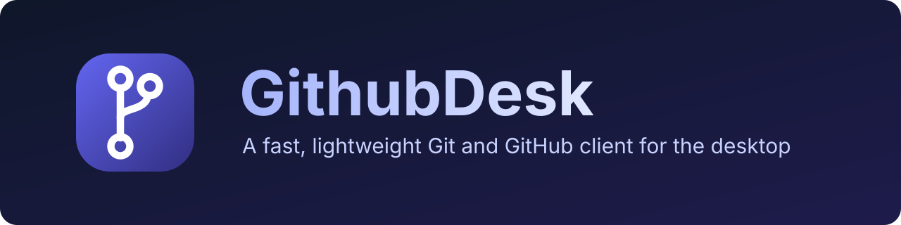
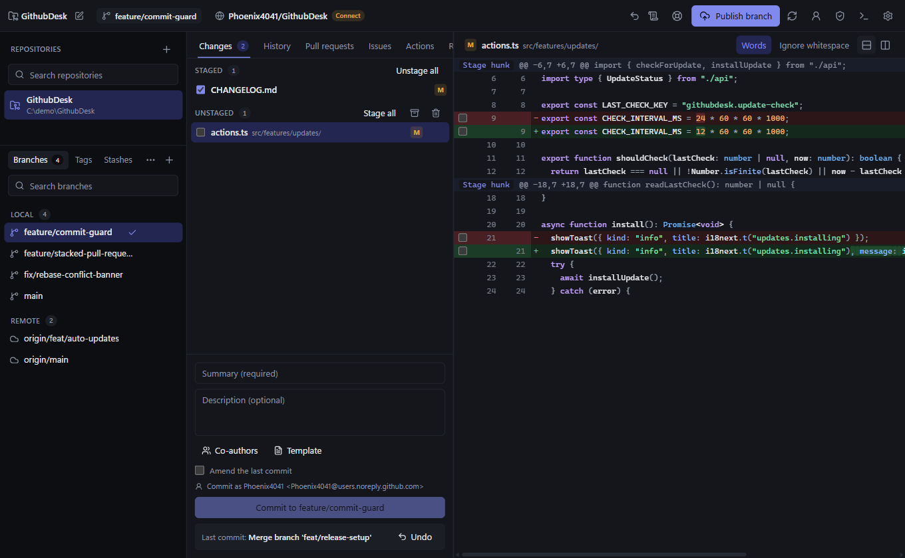
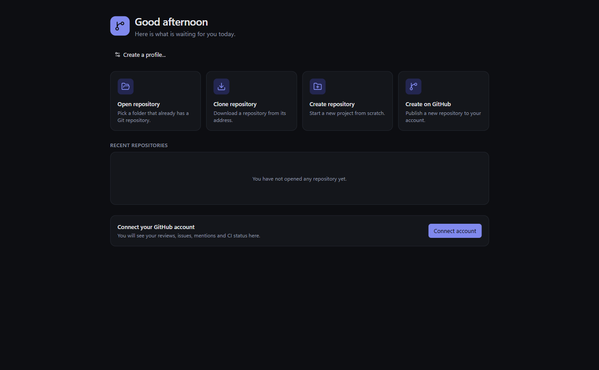
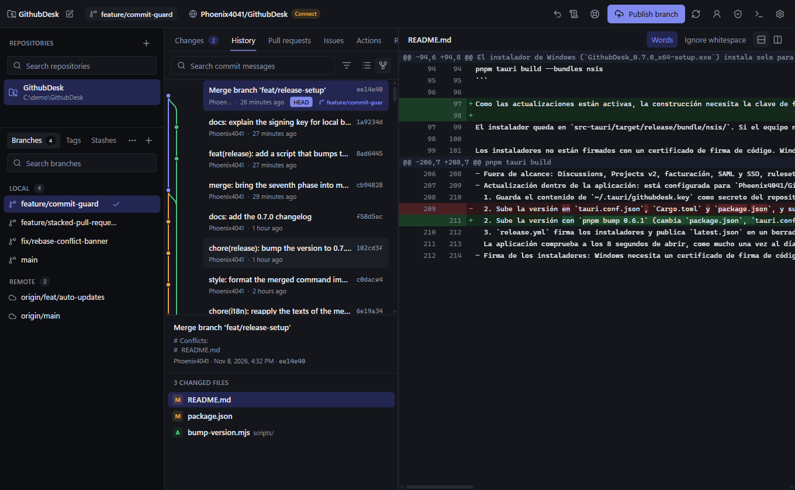
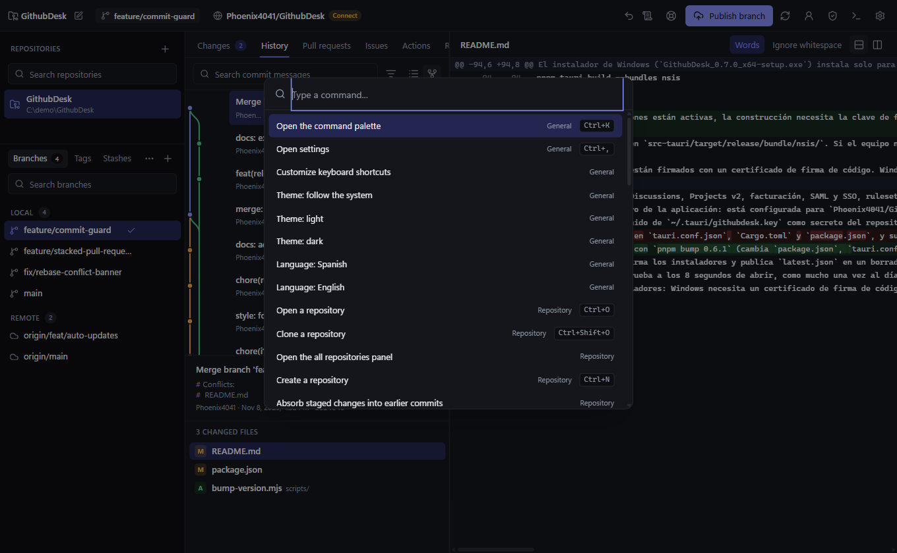

<div align="center">



<br>

[](https://github.com/Phoenix4041/GithubDesk/releases/latest)
[](https://github.com/Phoenix4041/GithubDesk/actions/workflows/ci.yml)
[](LICENSE)
[](https://github.com/Phoenix4041/GithubDesk/releases)


**[Download](https://github.com/Phoenix4041/GithubDesk/releases/latest)** &nbsp;|&nbsp; **[Features](#features)** &nbsp;|&nbsp; **[Build from source](#build-from-source)** &nbsp;|&nbsp; **[Leer en español](README.es.md)**

</div>

---

GithubDesk is a desktop client for Git and GitHub. It runs the real `git` binary on your machine, so it behaves exactly like the command line, and puts everything you normally reach for on github.com (pull requests, issues, Actions, releases, repository settings) next to your working tree.

It is built with Tauri 2, so it starts fast and stays small: around 140 MB of memory with a repository open, and a repository with 100,000 commits shows its first page of history in under a second.

<p align="center">
  
</p>

## Why GithubDesk

- **Fast and light.** Native Rust backend, virtualized lists everywhere, and no bundled browser.
- **Real Git, no surprises.** It shells out to your installed `git` and parses stable porcelain output, so hooks, config, signing and LFS all work as they do in the terminal.
- **GitHub without the browser.** Review pull requests, triage issues, watch workflow runs and manage repository settings without leaving the app.
- **Safe by default.** Destructive actions save a recoverable copy first, and a pre-commit guard warns about secrets and large files.
- **Private.** Tokens live in your operating system's credential store, never in plain files. Nothing is sent anywhere except to GitHub.

## Screenshots

<table>
  <tr>
    <td width="50%"></td>
    <td width="50%"></td>
  </tr>
  <tr>
    <td align="center"><sub>Start screen</sub></td>
    <td align="center"><sub>History with branch graph</sub></td>
  </tr>
  <tr>
    <td colspan="2"></td>
  </tr>
  <tr>
    <td colspan="2" align="center"><sub>Command palette (Ctrl+K) with every action in the app</sub></td>
  </tr>
</table>

## Features

### Everyday Git

- Clone, open and create repositories, with a recents list and live file watching.
- Stage by file, hunk or single line. Commit, amend and undo.
- Branches: create, switch, rename, delete and publish, with ahead and behind counts.
- Merge with a preview and three modes (normal, no fast-forward, squash), rebase, cherry-pick, revert, and soft, mixed or hard reset.
- Interactive rebase with drag and drop: reorder, squash, drop, reword and stop to edit.
- Three-pane conflict editor with per-block choices, plus binary and deleted-file conflicts.
- Stash with untracked files, tags (lightweight and annotated), worktrees, submodules and Git LFS.
- Blame, file history, branch comparison, patch export and import, and guided bisect.
- Safe pushes with `--force-with-lease` whenever history is rewritten.

### History and diffs

- Searchable history by message, author, changed text, path and date, with a graph view.
- Unified and split diffs with word-level highlighting and an ignore-whitespace mode.
- Browse the files of any commit, restore a file to that version and compare images side by side, with a slider or with an overlay.
- Reflog timeline with undo, and recovery of any lost commit into a new branch.
- Repository statistics: activity, contributors, most changed files, bus factor and TODO count.

### Safety nets

- **Rescue.** Before discarding changes, a hard reset, a forced branch delete, a clean, an aborted operation or a dropped stash, a copy is saved under `refs/githubdesk/rescue` and can be recovered from a dialog.
- **Pre-commit guard.** Staged additions are checked for secrets, very large files, conflict markers and files that usually should not be committed.
- **Conflict predictor.** The branch list marks which branches would conflict with the current one, without touching your working tree.
- Absorb staged hunks into the unpublished commits that wrote those lines, split an unpublished commit by file, and restack chained branches in one go.

### GitHub

- Multiple accounts and profiles that combine an account, a context (personal or organization) and a Git identity, remembered per repository.
- Sign in with the Git credential manager or by importing your GitHub CLI session. No OAuth App needed, though one is supported.
- Pull requests: conversation, files with inline review comments, checks, reviews, merge (merge, squash or rebase), draft state, reviewers, labels, assignees and milestones.
- Issues: search, labels, comments, create, close with a reason and reopen.
- Actions: runs with filters, jobs and steps, job logs, re-run, cancel and manual dispatch.
- Releases with generated notes and attached files, labels and milestones.
- Repository settings: collaborators, teams, protected branches, webhooks, deploy keys, Actions secrets and variables, and Dependabot alerts.
- Account tools: profile, SSH, signing and GPG keys, emails, token permissions, organizations, members and invitations.
- Notifications inbox with optional desktop alerts.

### Productivity

- Start screen with recent repositories, pull requests waiting for your review, failing CI and assigned issues.
- Command palette that jumps to repositories, branches, pull requests, issues and files, with rebindable keyboard shortcuts.
- Integrated terminal opened in the repository folder (PowerShell, Git Bash, cmd, bash or zsh).
- Open in your editor (VS Code, Cursor, Zed, Sublime, Notepad++ or your own) and reveal in the file explorer.
- Tray icon, background fetch, single instance, `githubdesk://` links and an Open with GithubDesk entry in the Explorer menu.
- Custom themes with VS Code color import, adjustable density, English and Spanish.
- Built-in updates: the app checks for new versions and installs them after verifying their signature.

## Install

Download the latest installer from the [releases page](https://github.com/Phoenix4041/GithubDesk/releases/latest):

| System | Download |
| --- | --- |
| Windows 10 and 11 | `GithubDesk_<version>_x64-setup.exe` (installs for your user, no administrator rights) |
| macOS 13.3 or later | `GithubDesk_<version>_universal.dmg` |
| Linux | `GithubDesk_<version>_amd64.AppImage` or `.deb` |

Git must be installed and available on your `PATH`.

The installers are not signed with a code-signing certificate yet. Windows SmartScreen and macOS Gatekeeper will show a warning the first time: on Windows choose More info and then Run anyway, and on macOS open the app with a right click and then Open. Updates delivered through the app are verified with a signature, so only builds from this project can update an existing installation.

For a silent install on Windows, run the installer with `/S`, and run `uninstall.exe /S` from the install folder to remove it.

### Platform status

| System | Status | Minimum web engine |
| --- | --- | --- |
| Windows 10 and 11 | Tested by hand in every release | WebView2 111 or later (updates itself) |
| Linux | Builds, passes the test suite and starts on Ubuntu 26.04 (WSL2) | WebKitGTK 2.40 or later |
| macOS | Built and tested in CI, not yet tested on real hardware | macOS 13.3 or later |

## Connect GitHub

Open Settings and choose Add account. You can sign in with:

- **The Git credential manager or GitHub CLI.** The app uses the session you already have. No setup.
- **A personal access token** with the `repo`, `workflow` and `read:org` scopes. Works with github.com and GitHub Enterprise.
- **An OAuth App** using the device flow: create one in GitHub, enable the device flow and paste its client ID.

Tokens are saved in the credential store of your system (Credential Manager on Windows, Keychain on macOS, Secret Service on Linux). Pull requests, issues and Actions appear whenever a remote of the repository points to GitHub or to a server with a connected account.

## Keyboard shortcuts

Every shortcut can be changed in Settings or from the command palette. On macOS, use Cmd instead of Ctrl.

| Shortcut | Action |
| --- | --- |
| `Ctrl+K` | Command palette |
| `Ctrl+J` | Show or hide the terminal |
| `Ctrl+1` to `Ctrl+5` | Changes, History, Pull requests, Issues and Actions |
| `Ctrl+Shift+F`, `Ctrl+Shift+L`, `Ctrl+P` | Fetch, pull and push |
| `Ctrl+Shift+N` | New branch |
| `Ctrl+Shift+S` | Stash changes |
| `Ctrl+Shift+E` | Open in the external editor |
| `Ctrl+Shift+X` | Show in the file explorer |
| `Ctrl+,` | Settings |

## Build from source

Requirements:

- Git on your `PATH`
- Node.js 24 or later and pnpm
- Rust stable 1.90 or later (MSVC toolchain on Windows)
- Windows: Visual Studio Build Tools with the C++ workload, and WebView2
- Linux: `libwebkit2gtk-4.1-dev`, `libgtk-3-dev`, `libayatana-appindicator3-dev`, `librsvg2-dev`, `libsoup-3.0-dev` and `libdbus-1-dev`

Run in development mode:

```bash
pnpm install
pnpm tauri dev
```

Check the code:

```bash
pnpm typecheck
pnpm lint
pnpm test
cargo test --manifest-path src-tauri/Cargo.toml
cargo clippy --manifest-path src-tauri/Cargo.toml --all-targets
```

Build the installer:

```bash
pnpm tauri build --bundles nsis
```

Because updates are enabled, a build needs the signing key in the environment: set `TAURI_SIGNING_PRIVATE_KEY` to the path of your private key and `TAURI_SIGNING_PRIVATE_KEY_PASSWORD` to its password, if it has one. Generate a key with `pnpm tauri signer generate -w ~/.tauri/githubdesk.key`.

## Releasing

1. Bump the version with `pnpm bump 0.7.1`. It updates `package.json`, `tauri.conf.json` and `Cargo.toml`. Run `cargo check` inside `src-tauri` to refresh `Cargo.lock`.
2. Commit and push a tag such as `v0.7.1`.
3. The release workflow builds and signs the installers for Windows, macOS and Linux and creates a draft release with a `latest.json` file.
4. Publish the draft. Installed apps only see a release once it is published.

The repository needs the `TAURI_SIGNING_PRIVATE_KEY` secret (and `TAURI_SIGNING_PRIVATE_KEY_PASSWORD` if the key has a password). The public key lives in `src-tauri/tauri.conf.json`.

## Project structure

| Path | Purpose |
| --- | --- |
| `src-tauri/` | Rust backend. Runs the system `git` binary and parses stable output formats. |
| `src-tauri/src/commands/` | One module per area. Every command is async so the window never blocks. |
| `src-tauri/src/git/parse/` | Parsers for git output, with unit tests. |
| `src-tauri/src/github/` | GitHub REST client with pagination, ETag caching and typed errors, plus accounts, pull requests, issues and Actions. |
| `src-tauri/tests/` | Integration tests that use real repositories and a local HTTP server that imitates GitHub. |
| `src/features/` | One folder per interface feature. |
| `src/shared/` | Shared components, utilities and hooks. |
| `src/i18n/` | Interface texts per language. |

Design notes and known limits for each development phase are in [docs/notas-tecnicas.md](docs/notas-tecnicas.md), written in Spanish. Release notes are in [CHANGELOG.md](CHANGELOG.md).

## Contributing

Issues and pull requests are welcome. Before opening a pull request, run `pnpm typecheck`, `pnpm lint`, `pnpm test` and the Rust tests. Commits follow [Conventional Commits](https://www.conventionalcommits.org), the code is strictly typed with no `any`, and files and folders use kebab-case.

## License

GithubDesk is released under the [MIT License](LICENSE).
